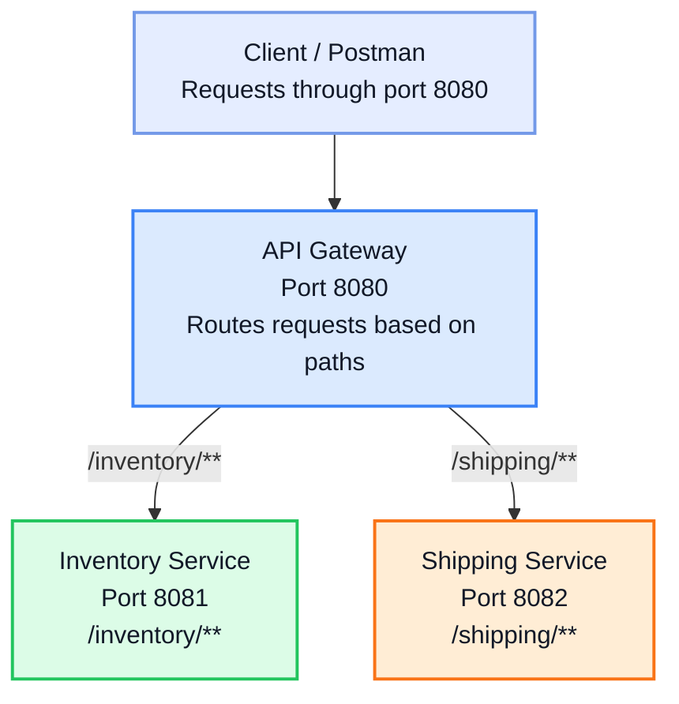

# Centralized API Gateway Routing

## Project Overview

This project demonstrates centralized API Gateway routing using Spring Boot microservices. The API Gateway acts as a single entry point for client requests and routes them to the appropriate downstream service based on the request path.

## Architecture

The following diagram illustrates how the client sends requests through the API Gateway, which routes them to the appropriate microservice based on the request path.



### Request Flow

1. The client sends a request to the API Gateway on port `8080`.
2. The API Gateway checks the incoming request path.
3. Requests matching `/inventory/**` are routed to the Inventory Service on port `8081`.
4. Requests matching `/shipping/**` are routed to the Shipping Service on port `8082`.
5. The respective microservice processes the request and returns a JSON response through the gateway.

## Technologies Used

- Java
- Spring Boot
- Spring Cloud Gateway
- REST APIs
- Maven

## Project Structure

```text
centralized-api-gateway-routing/
├── Inventory-service/
├── Shipping-service/
├── api-gateway/
└── README.md
```

## Service Configuration

| Application | Port | Endpoint |
|---|---:|---|
| API Gateway | 8080 | `http://localhost:8080` |
| Inventory Service | 8081 | `http://localhost:8081/inventory` |
| Shipping Service | 8082 | `http://localhost:8082/shipping` |

## Gateway Routing

The API Gateway forwards requests based on their URL paths:

- `/inventory` and `/inventory/**` → Inventory Service (`8081`)
- `/shipping` and `/shipping/**` → Shipping Service (`8082`)

## How to Run

1. Import all three projects into Spring Tool Suite (STS) as existing Maven projects.
2. Start the Inventory Service on port `8081`.
3. Start the Shipping Service on port `8082`.
4. Start the API Gateway on port `8080`.
5. Open the following URLs in a browser to test the routing:
   - [Inventory Endpoint](http://localhost:8080/inventory)
   - [Shipping Endpoint](http://localhost:8080/shipping)

## Expected Results

- The Inventory endpoint returns JSON containing product and quantity details.
- The Shipping endpoint returns JSON containing order and delivery status details.
- Both services can be accessed through the single API Gateway on port `8080`.

## Learning Outcomes

- Understanding microservices architecture.
- Creating REST endpoints using Spring Boot.
- Configuring path-based routing with Spring Cloud Gateway.
- Testing centralized access to multiple microservices.

## Author

**Bhanu**

## License

This project is created for educational and learning purposes.
